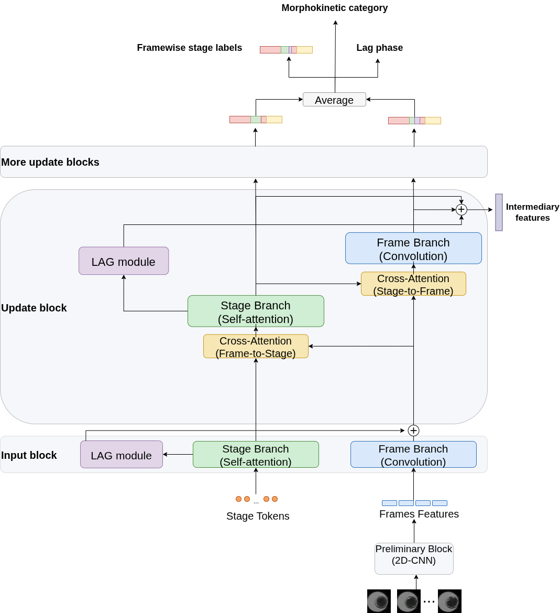

# MKLag: Fine-grained classification of bovine embryo morphokinetic profiles from time-lapse videomicroscopy

<!-- TODO: authors, affiliations -->
**Y. Hachani**, **P. Bouthemy**, **E. Fromont**, **V. Duranthon**, **L. Laffont**, **A. De Paula Reis**

<!-- TODO: venue / year -->
[**📄 Paper**](TODO-link-to-paper)

MKLag is a model for time-lapse videos of bovine embryos. From one video, it jointly predicts:

- the **developmental stage of every frame** (cytokinesis (CDT), 1 to ≥ 9 cells, or blocked)
- the **LAG phase**
- the **morphokinetic category** of the embryo (EHB, HB, SSB, ADB or NT)

This biologically-informed design was motivated by an analysis of morphokinetic parameters annotated by an expert. Benchmark evaluations demonstrated that MKLag significantly outperforms existing methods.

<div style="text-align: center;">
  
</div>

---

## Repository structure

| Path | Content |
|---|---|
| `train.py`, `inference.py`, `processResults.py` | training, inference, metrics computation|
| `configs/` | configuration files |
| `models/` | MKLag model, losses, optimisers |
| `DataLoading/` | dataset and label construction from the annotation CSV |
| `Metrics/` | classification and temporal localisation metrics |
| `DataSplit/` | annotation CSV (train, val, test splits) |

## Installation

```bash
git clone https://github.com/Yass3576/MKLAG && cd MKLAG
conda create -n mklag python=3.11 -y && conda activate mklag
pip install -r requirements.txt
```

## Data

MKLag does not read the videos directly. It takes pre-computed per-frame embeddings: one `<video_name>.npy` file per video, of shape `(T, in_dim)`. Download the pre-computed embeddings from this [**link**](TODO-link-to-dataset).


### Annotation CSV

The annotations are CSV files in `DataSplit/<dataset>/{train,val,test}/<name>.csv`, with one row per video.

| Column | Meaning |
|---|---|
| `video` | name of the video|
| `t0` | time of the first frame (minutes) |
| `EC{i}_times` | cytokinesis start-end pairs of embryonic cycle i (minutes, separated with `-`) |
| `EC{i}_cells` | cell count at the end of the embryonic cycle |
| `EC{i}_ok_ciray/cda` | whether the cycle is valid under each annotation framework |
| `LAG` | start-end pair `t_s1-t_e1` (minutes) |
| `Category` | the morphokinetic category (EHB, HB, SSB, ADB, or NT) |


## Training

```bash
python train.py --cfg configs/bovine.yaml
python train.py --cfg configs/bovine.yaml --set seed 1 data.batch_size 16  data.embeddings_path /path/to/frame_embeddings/ # use --set to override any config key
```

Logs go to Weights & Biases. Use `WANDB_MODE=offline` on machines without internet.

## Evaluation

```bash
python inference.py --cfg configs/bovine.yaml --out preds/seed93.pkl \
                    --set ckpt results/<experiment>/<run_id>/checkpoints/last.ckpt
mkdir -p res
python processResults.py --path_to_pickle preds/seed93.pkl --out res/seed93 --tasks cat dev lag --n_tclasses 5
python processResults.py --mean_cm preds/seed1.pkl preds/seed76.pkl preds/seed93.pkl --out res/mean --n_tclasses 5
```

`processResults.py` computes the following:
- **Morphokinetic category**: accuracy, per-class precision / recall / F1 / IoU, and the confusion matrix.
- **Developmental stages**: the same metrics, at the frame level.
- **LAG**: detection and localisation metrics of the segments (IoU, start / end / duration errors).
- With `--mean_cm`: the confusion matrix averaged over several runs, with its standard deviation.

## Pretrained model

| Model | Embeddings | Classes | Checkpoint |
|---|---|---|---|
| MKLag | ResNet-50 (2048) | 5 | checkpoints/MKLAG_s1303/mklag.ckpt |


## Acknowledgements

The temporal backbone (FACT blocks, matching and frame/action losses) is adapted from [CVPR2024-FACT](https://github.com/ZijiaLewisLu/CVPR2024-FACT). 
